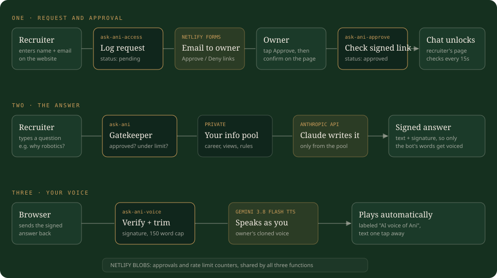

# Ask Ani

A private, voice enabled AI version of me that answers recruiters' questions on my website, using only facts I wrote down myself.

I built this as one of my own AI projects. I'm a go to market operator, not a software engineer, and I built it by directing an AI coding agent step by step: deciding the architecture, testing every answer, and pushing back when something didn't sound like me. This repo is the result, open so anyone can build their own.

## What it does

1. **Request and approval.** A visitor enters their name and email. Nothing opens until I approve them from a private admin page.
2. **The answer.** Claude answers in first person, only from a profile file I control. If the answer isn't there, it says so and points to my email. No guessing.
3. **The voice.** The answer plays in my own cloned voice through Gemini text to speech, labeled as AI. The text is always one tap away.

## Why I built it this way

- **Facts only from my profile.** Every claim must be in `knowledge/profile.md`. Confidential numbers, my phone number and anything else I list under "Never share" stay out.
- **I decide who talks to it.** Access is approval based, so it's a tool for recruiters I'm already in touch with, not a public toy.
- **The voice only says what the bot wrote.** Every answer is signed on the server, and the voice endpoint refuses anything unsigned.
- **Costs stay predictable.** Rate limits per visitor and per day, a word cap on audio, and a cost log line for every call.
- **Swappable parts.** The brain is one model setting; the voice provider sits behind one small module (`netlify/lib/tts.mjs`).

## How it's built

Plain HTML plus a small JavaScript widget, and four Netlify Functions. No framework.

| Piece | File | Job |
|---|---|---|
| Chat widget | `ask-ani.js` | Button, access request, chat panel, autoplay voice |
| Access request | `netlify/functions/ask-ani-access.mjs` | Saves a pending request |
| Admin page | `netlify/functions/ask-ani-admin.mjs` | Your private list with Approve and Deny |
| Approval | `netlify/functions/ask-ani-approve.mjs` | Checks the signed button, records the decision |
| Answer | `netlify/functions/ask-ani.mjs` | Gatekeeping, profile, Claude, signed reply |
| Voice | `netlify/functions/ask-ani-voice.mjs` | Verifies the signature, Gemini speaks it |
| Storage | Netlify Blobs | Approvals and rate limit counters |

## Build your own

You need a Netlify account, an Anthropic API key, and (for voice) a paid tier Gemini API key.

1. **Clone and install.** `git clone`, then `npm install`.
2. **Write your profile.** Copy `knowledge/profile.example.md` to `knowledge/profile.md` and fill it in, first person. This is everything the bot knows.
3. **Set your secrets.** Copy `.env.example` to `.env` and fill it in. Generate the two secrets with `openssl rand -base64 48`.
4. **Run it locally.** `npm run dev`, then open `http://localhost:8899/demo/`. The admin page is `http://localhost:8899/api/ask-ani-admin?key=YOUR_ADMIN_KEY`.
5. **Clone your voice (optional).** Record about 20 seconds of natural speech as `voice/ani_reference.wav`, and the consent sentence Google requires as `voice/ani_consent.m4a` ("I am the owner of this voice and I consent to Google using this voice to create a synthetic voice model."). Same room, same mic, no volume boost, or Google's speaker match check fails. Then `npm run create-voice`.
6. **Check everything.** `npm run preflight` lists what's set and what's missing, without printing any secret.
7. **Deploy.** Put the widget on your site with `` and ``, connect the repo to Netlify, and add every `.env` value under Site configuration, Environment variables. Keep your profile out of any public repo; this one ignores `knowledge/` on purpose.

## Choosing the model

`ASK_ANI_MODEL` picks the Claude model. In my testing, `claude-sonnet-5` stayed grounded and concise at a low cost per answer. Smaller models were more likely to add claims that weren't in the profile, which matters when recruiters are reading.

## Lessons from building it

- Grounding beats cleverness. The hardest part wasn't the code, it was writing a profile good enough to answer real questions.
- Test like a recruiter. I asked it about salary, visa, why I left each job, and tried to make it reveal its instructions.
- Listen to your clone before you ship it. I rejected a "deeper" voice setting because it stopped sounding like me.

## License

MIT. Build your own, and tell me what you made.
